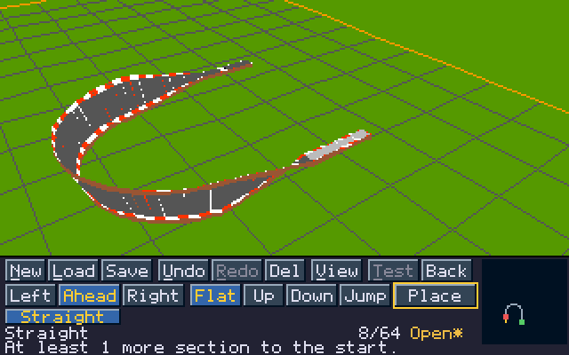

# Stunt Car Racer Performance patcher

**Version 2.3.1.** This release is primarily intended for emulation.
It provides **50 Hz physics and rendering at up to 50 FPS, while lap timers retain their original 8.33 Hz update rate**, and detects PAL or NTSC displays at boot.
The achieved frame rate depends on the machine's Chip RAM access speed; game speed stays correct when frames are late.
**Timing Original** in [Settings](#settings) races with the original game loop and physics instead.

The patcher writes a [WHDLoad install](WHDLOAD.md) of the game for a hard disk.
From this version on, releases are WHDLoad installs only. The previous version,
[1.6.3](https://github.com/timoheimonen/amiga-stunt-car-racer-060-performance-patch/tree/Release/1.6.3), still includes the disk version.

## Requirements

- Python 3.8+; no additional packages or assembler needed to write the install.
- Primarily an emulated Amiga with PAL or NTSC, MC68060, 2 MiB Chip RAM and at least
  2 MiB Fast RAM ([requirements](PATCH.md#requirements)). Lower frame rates may call
  for adjusting **Game Speed** in [Settings](#settings).
- [WHDLoad](https://www.whdload.de/) 17 or later.
- Your own original Stunt Car Racer ADF matching the
  [supported checksum](PATCH.md#checksums), and your own Kickstart ROM.

## Usage

```sh
python3 patch.py "/path/to/Stunt Car Racer.adf"
```

Creates the new install directory `StuntCarRacerPerf` and its drawer icon
`StuntCarRacerPerf.info` beside the original. To write them elsewhere, name
the directory after the ADF:

```sh
python3 patch.py "/path/to/Stunt Car Racer.adf" /path/to/Games/StuntCarRacerPerf
```

Nothing is replaced: an existing directory or drawer icon stops the patcher,
and the original ADF is only read. `python3 patch.py --version` prints the
package version.

Copy the directory and its drawer icon to the Amiga and start the game from
its icon, `StuntCarRacerPerf`. The intro is skipped, the loading picture stays
for 3 seconds (or with WHDLoad's ButtonWait option until a button is pressed),
season saves are files in the install directory, and custom tracks and their
records are files in its `tracks` drawer. The install's own file names let it
share a directory with other WHDLoad installs of the game. See [WHDLoad install](WHDLOAD.md).

## Track Editor



Build your own circuits inside the game from complete sections of the original
tracks. The [Track Editor manual](docs/track-editor.md) has a first track step
by step, every control and every message.

- **A bar of buttons** sits below the 3D view and shows every command. A mouse
  in port 1 clicks them, and the keyboard and the joystick still work. A dimmed
  button says why on the line below.
- **A new track** starts on the map: put the start line down, then add sections
  by turn, slope and kind. Line 2 says how far the start is and which section
  closes the track. A track has up to **78 road pieces**.
- **Finish** builds the rest of an open track for you, and **Del** in the middle
  of a track leaves a gap to build again.
- **Hold the right mouse button and drag** to look around. **W A S D** move the
  camera and **Q Z** raise and lower it. **V** shows the whole track.
- **Test** drives the track in memory; nothing is saved. **Undo** and **Redo**
  reach back 16 steps.
- **New** can also start from a ready-made track.
- **Race the computer** on your own tracks: choose a track in **Practise**,
  then **Race**.

The track list has **512 save slots** on 32 pages, and each slot is a file in
the install's `tracks` drawer: slot 7 is `Track007.sct`, and renaming a file
moves the track to that slot. Slots 1-3 contain the ready-to-drive example
tracks **BUILD**, **BUILD 2** and **BUILD 3**; saving over one replaces it
after confirmation. Draft tracks can be saved and resumed; only validated
**Ready** tracks appear in **Practise**, where each one is driven alone or
raced once against a computer driver chosen at random. The original eight tracks remain
available. Custom tracks retain their own best lap and race times, separately
for normal and super league. Record eligibility requires Game Speed at 100%, Infinite Boost No,
Disable Damage No and Timing Performance.

Tracks and records of versions 1.6.0 to 2.2.0 come along: copy the old
`Track01.sct` to `Track32.sct` and `.rec` files into the new install directory,
and the game offers to import them into `tracks` when it starts
([how](docs/track-editor.md#tracks-from-an-older-version)). The
[Track File Format](docs/track-format.md) describes the files byte by byte.

## Computer Link (Beta)

Two machines race each other over their serial ports (null-modem link). Both
must run this version in PAL.

1. Choose **Computer Link** in the main menu on both machines.
2. Press **H** on one machine (Host) and **J** on the other (Join).
   **Esc** returns to the menu.

The Host's menu choices, including Settings, apply to both machines. Each
machine runs its own 50 Hz physics; car positions are exchanged 20 times per
second and the other car is shown smoothly with a short delay. Cars pass
through each other. Pause, leaving the race, wrecks, results and points are
shared. A tie is awarded to the Host. Link races do not change the records on
either machine.

The link championship runs four seasons through Divisions 4, 3, 2 and 1, the
last one being the FINAL SEASON. Points accumulate over all four seasons and
the driver with the most points after Division 1 wins. Each new link
championship starts in Division 4.

## Settings

**Settings** in the main menu.

- **Game Speed:** 100-150%, in 5% steps.
- **AI Difficulty:** 100-150%, in 5% steps.
- **Infinite Boost:** No/Yes.
- **Disable Damage:** No/Yes.
- **Timing:** Performance/Original. **Performance** is the 50 Hz game.
  **Original** races with the original 120 ms game loop and physics, with the
  faster drawing still on. Game Speed then shows 100%; the value set for
  Performance is kept. Original races do not set records on the original tracks,
  and custom tracks keep their times for the session only. Computer Link races
  always use Performance.


[Changelog](CHANGELOG.md) · [Checksums](PATCH.md#checksums) ·
[Patch details](PATCH.md) · [WHDLoad install](WHDLOAD.md) ·
[Track Editor manual](docs/track-editor.md) ·
[Track File Format](docs/track-format.md) · [Assembly sources](src)

Timo Heimonen (timo.heimonen@proton.me) · [MIT License](LICENSE)

The license covers the patch code and documentation. Original game disks
and Kickstart ROMs are not included.
