# Track Editor manual

For Stunt Car Racer Performance version 2.2.0.

The Track Editor lets you build your own circuits inside the game, from complete
sections taken from the original tracks: banked corners with their entry and exit,
hills, crests and a ramp with its landing. You drive a finished track in Practise,
and the game keeps its best lap times.

- [What you need](#what-you-need)
- [The screen](#the-screen)
- [Your first track](#your-first-track)
- [Looking around](#looking-around)
- [Choosing a section](#choosing-a-section)
- [Closing the track](#closing-the-track)
- [Changing a track](#changing-a-track)
- [Test drive](#test-drive)
- [Saving and loading](#saving-and-loading)
- [Driving and racing your tracks](#driving-and-racing-your-tracks)
- [Controls](#controls)
- [All sections](#all-sections)
- [Messages](#messages)
- [Limits and older tracks](#limits-and-older-tracks)

## What you need

- The WHDLoad install of the game, see [WHDLoad install](../WHDLOAD.md).
- A mouse in port 1. The editor also works with the keyboard alone, and a joystick
  in port 2 can build a whole track, but looking around needs the mouse or the keys.
- A joystick in port 2 to drive.
- The keyboard to type a track name. Without it a new track keeps the name it offers.

Open **4. Track Editor** from the main menu. In Practise the same editor is
under **Track Editor** in the track menu.

## The screen

The 3D view fills the top of the screen and a bar of buttons sits below it. Every
command is on the bar, so nothing has to be remembered.

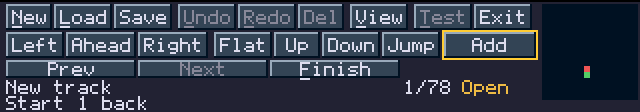

| Part | What it is |
| --- | --- |
| Top row | Commands: **New**, **Load**, **Save**, **Undo**, **Redo**, **Del**, **View**, **Test**, **Exit**. |
| Second row | What to build: turn, slope and the main button. The main button has a yellow frame. |
| Third row | **Prev**, **Next** and **Finish**, or the sections you can choose from. |
| Line 1 | The name of the section, then the road pieces used, for example `14/78`, and the track state. |
| Line 2 | What the game has to say. |
| Map | The whole track from above, at the right edge. |

Move the mouse to move the pointer, and click a button with the left mouse button.
While the pointer is on a button, line 2 says what the button does. A dimmed button
does nothing, and line 2 says why. A key or the joystick hides the pointer until the
mouse moves again.

The track state is **Open** until the road comes back to the start, then **Ready**
when the track can be driven. A star, as in **Ready\***, means there are changes that
have not been saved.

On the map the selected section or the section you are trying is orange. On an open
track the end of the road is red. The start is green.

## Your first track

This short loop takes nine clicks and shows the whole idea. The steps use the mouse.
[Controls](#controls) lists the same commands for the keyboard and the joystick.

**1. Put down the start.** A new track opens on the map. If another track is open,
click **New**, then **Empty**. The start line waits on its square, and the arrow shows
which way it runs. Click **Place** to keep it there.

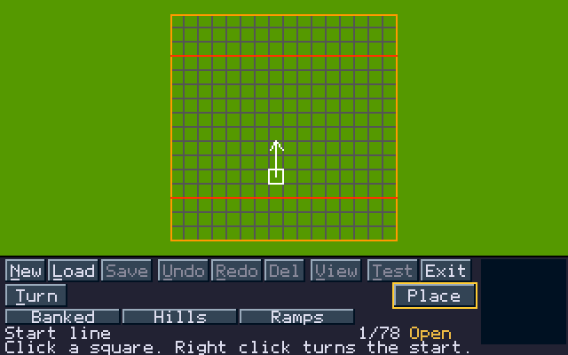

The view moves to the start, seen from behind and above. From now on only you move
the camera. Hold the right mouse button and drag to look around, and fly with
**W A S D**. The pictures below have the camera moved at every step, so that the new
section is in sight.

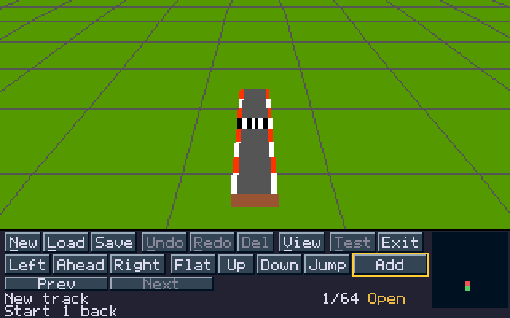

**2. Add a corner.** Click **Add**. The choices open and a light road shows the section
you are trying. Click **Left**, then **180** on the row below. Line 1 now says
`Left 180`, and line 2 tells you how far the start still is: `At least 2 more sections
to the start.` Click **Place**.

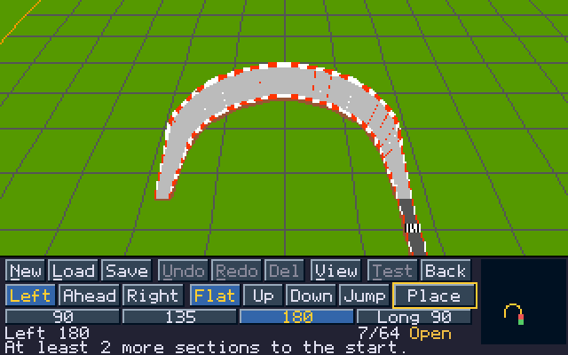

**3. Add a straight.** The choices stay open for the next section, and `Straight` is
already chosen. Click **Place**.

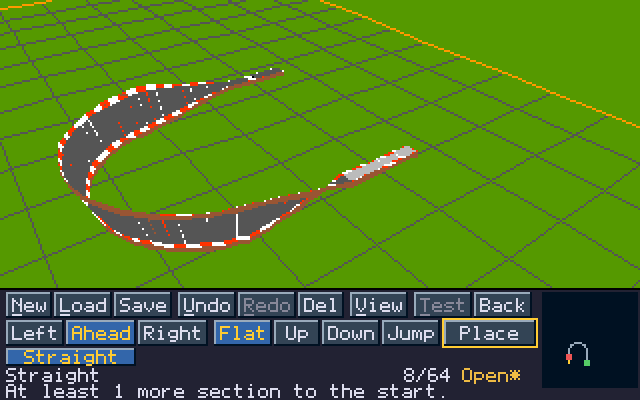

**4. Close the loop.** Click **Left**, then **180** again. The button turns green and
line 2 says `This section closes the track.` Click **Place**.

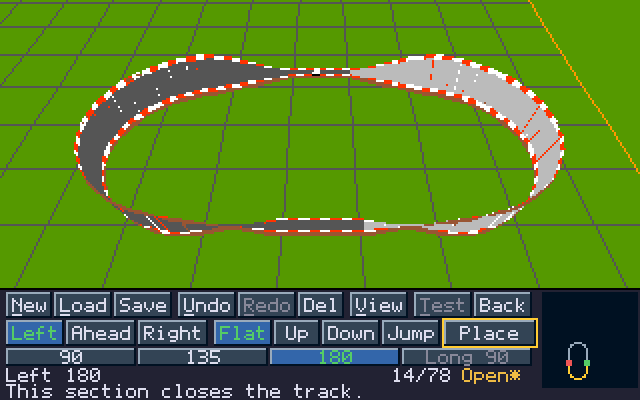

**5. Drive it.** The state now says **Ready**, and **Test** has its yellow frame. Click
**Test** and drive with the joystick. **Esc** brings you back with everything as it was.

**6. Save it.** Click **Save**, click a free row, type a name and press **Return**.
Line 2 says `Track saved.`, and the star is gone.

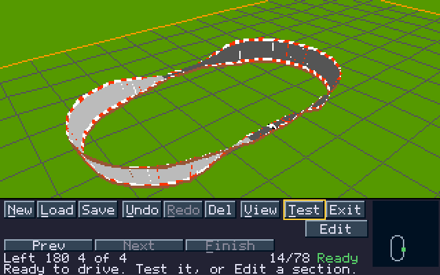

The track is now on the **Custom Tracks** list in Practise.

## Looking around

Each track opens on its start piece, seen from behind and above. After that only you
move the camera. Placing sections, **Prev**, **Next**, **Undo** and a test drive leave
it where it stands.

| Control | What it does |
| --- | --- |
| Hold the right mouse button and drag | Turn sideways, tilt up and down, from slightly up to straight down. |
| **W** / **S** | Move ahead and back. |
| **A** / **D** | Move sideways. |
| **Q** / **Z** | Move up and down. |
| **V** or **View** | Show the entire track. **V** goes back to the same place. |

These work while you build and while the choices are open. The camera moves at the same
speed on any track. While it moves, the view is drawn as road edges only, so that
it stays quick even on a long track. The full picture comes back when you stop.

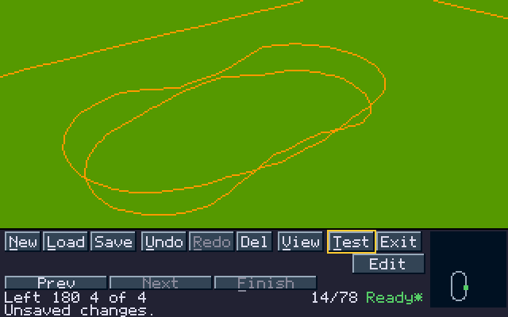

**V** is good for checking the whole shape:

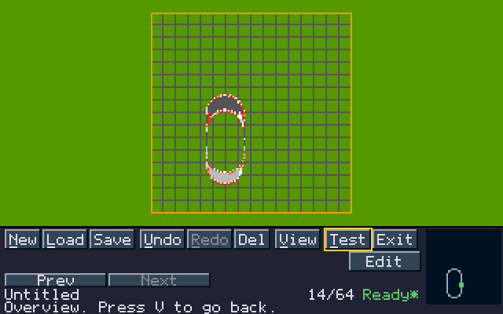

The joystick builds but does not move the camera. If the section you are trying is
out of view, the map still shows it.

## Choosing a section

**Add** opens the choices at the end of the road. Pick a section by what it does.

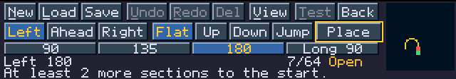

1. Click a turn: **Left**, **Ahead** or **Right**.
2. Click a slope: **Flat**, **Up**, **Down** or **Jump**.
3. Click a word on the row below, such as **Medium** or **180**. The words are the
   sections of that turn and slope. [All sections](#all-sections) lists them.
4. Click **Place**.

The view follows every click, so you can try sections freely. Nothing changes until
**Place**. **Back**, **Esc** or a right click closes the choices without placing.

| On the buttons | Meaning |
| --- | --- |
| Blue | What you have chosen now. |
| Green | This section closes the track. A green turn or slope has such a section. |
| Dimmed turn or slope | There is no section of that kind for this end of the road. |
| Dimmed word | The section does not fit here. Point at it and line 2 says why. |

With the mouse the choices stay open after **Place**, until the track closes. With the
keyboard or the joystick you are back at **Add**, and the next press opens them again.

### Hills and jumps

For a section that changes height, line 1 also shows the rise in height levels:
`Uphill medium +5 6/8` climbs five and three quarter levels, and `Downhill small -2`
drops two. The camera shows a hill best from the side.

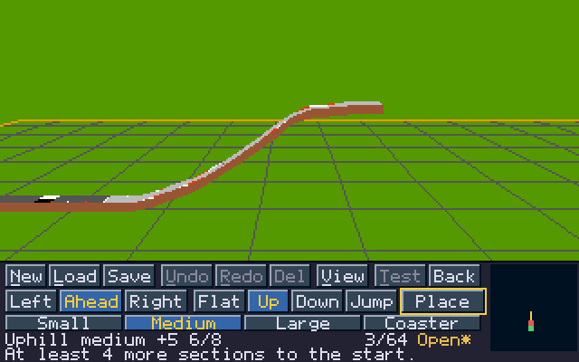

### A section that does not fit

A section that cannot go here turns red, and line 2 gives the reason. **Place** is
dimmed. Choose something else, or close the choices. A dimmed word that attaches to
the road can still be clicked, to see where it would go.

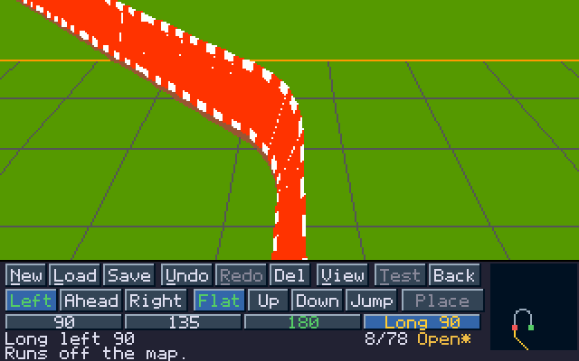

| Line 2 | What to do |
| --- | --- |
| `Too long: 78 pieces is the limit.` | The section would not fit in the 78 road pieces. Take a shorter one. |
| `Runs off the map.` | Turn back toward the middle of the map. |
| `Road would go too high.` | Go down first. |
| `Road would go too low.` | Go up first. |
| `Next section would not join.` | When replacing, the new section must meet the road that follows it. |
| `Crosses road already built.` | Move the road away. Tracks cannot cross themselves. |
| `Nothing fits here. Undo or Del.` | No section fits this end of the road. Take something back. |

## Closing the track

A track is finished when the road comes back to the start at the right height and
direction. While you choose, line 2 helps you get there:

| Line 2 | Meaning |
| --- | --- |
| `At least 3 more sections to the start.` | The shortest road on the map. It knows nothing of height or crossing road, so the real way can be longer. |
| `This section closes the track.` | Place it and the track is closed. |
| `No way back from here.` | No road can reach the start from where this section ends. |
| `Reaches the start at the wrong height.` | The shape is right but the height is not. |
| `Height never meets: undo the Downhill large.` | Only on a track built with an older version, such as the example track BUILD: its Downhill large left the road end at a height no other section can meet, so that section has to go. |
| `Height never meets: undo the steep descent.` | The same for its Coaster descent. |

Every section climbs or drops by a whole number of quarter levels, so the height
never stops a track from closing by itself: room on the map and the piece limit
still can.

While building, line 2 can also show where the start is, seen from the end of the road:

`Start 3 right 2 ahead +1 face R90`

This means the start line is 3 map squares to your right, 2 ahead and 1 height level
higher, and it points 90 degrees to the right of the way you are heading now. `L90`
would be to the left, and `180` back toward you.

A closed track is checked further. If it is closed but still not **Ready**, line 2 says
why, see [Messages](#messages).

### Let the editor finish

**Finish**, or the F key, builds the rest of an open track. It looks for sections that
bring the road from its end back to the start, by the same rules as the choices: room on
the map, the height limits, the piece limit and the road already built. If there is no
way from the end as it is, it takes off the last section, as **Del** would, and looks
again, then two, and so on. The start section always stays.

While it looks, line 2 says `Looking for a way to close the track.` This takes a moment,
on a long track a second or more. Then line 2 says what it did:

| Line 2 | Meaning |
| --- | --- |
| `Closed with 2 more sections.` | Two sections were added, and the track is closed. |
| `Closed: took off 4, added 5 sections.` | The last four sections were taken off first. |
| `Found no way to close the track.` | Nothing was changed. |

All of it is one step: **Undo** brings the track back as it was, the sections taken off
included. The camera stays where it is, so press **View** to see the whole track.

With a gap in the track **Finish** fills the gap instead, taking off sections before the
gap if it has to: `Gap filled with 2 sections.` or `Found no way to fill the gap.`

On a closed track **Finish** is dimmed. Tracks saved by older versions do not show it.

## Changing a track

**Prev** and **Next**, or the Left and Right arrows, select a section. It is drawn with a
light road, and line 1 shows its name and number, such as `Left 180 2 of 4`. Left from
the start line goes round to the last section. Holding **Prev** or **Next** repeats.

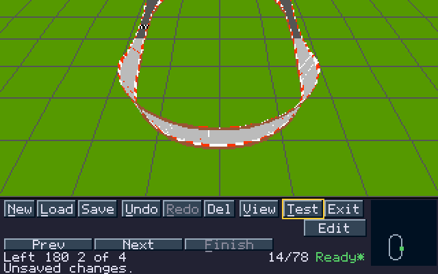

| Button | What it does |
| --- | --- |
| **Add** | At the end of an open road: add the next section. |
| **Edit** | Replace the selected section. The new one must join the road on both sides, and the rest of the track stays in place. |
| **Del** | Remove the last section. With a section in the middle selected, remove only that section and leave a gap, see [A gap in the track](#a-gap-in-the-track). |
| **Undo** | Take back the last add, replacement or removal. |
| **Redo** | Bring back what **Undo** took. |
| **Exit** | Leave the editor. |

There are 16 levels of undo. A new edit clears the redo steps. Saving keeps both, and
**New** and **Load** clear them.

The start line itself cannot be replaced or removed. If you remove every other section,
you are back on the map and can move the start. **Undo** is off on that page: click
**Place** first, then **Undo** brings the road back.

### A gap in the track

**Del** with a section in the middle selected removes only that section. The rest of the
track stays where it is, and a gap is left in the road. The selection moves to the gap,
and **Add** builds there just as at the end of an open road. Line 2 now leads to the far
side of the gap instead of the start, and the map marks both ends of the gap.

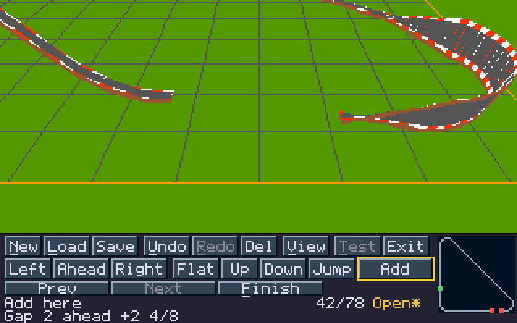

| Line 2 | Meaning |
| --- | --- |
| `At least 2 more sections to the gap.` | The shortest road on the map to the far side of the gap. |
| `This section fills the gap.` | Place it and the road is whole again. A track that was closed is closed again. |
| `No way to the gap from here.` | No road can reach the gap from where this section ends. |
| `Reaches the gap at the wrong height.` | The shape is right but the height is not. |
| `Gap 1 ahead` | Where the far side of the gap is, read as the guide to the start above. |

A section fills the gap when its end meets the road after the gap in direction and
height. Until then:

- **Prev** and **Next** go from the start line to the gap. The road after the gap cannot
  be selected, and **Edit** works on the sections before the gap.
- **Del** on the gap, or on the section right before it, removes that section and makes
  the gap wider. Elsewhere **Del** says `Fill the gap first.` There is one gap at a time.
- **Save** and **Test** say `Fill the gap first.`
- **Undo** and **Redo** bring the gap back with the track.
- **Finish** fills the gap, see [Let the editor finish](#let-the-editor-finish).

### Moving the start

A new track opens on the map page, and so does a track with every other section removed.

- Click a square, or use the arrow keys.
- **Turn**, **T** or a right click turns the start.
- **Place**, **Space** or **Fire** puts it down.
- On the joystick a direction moves the start, **Fire** held with Left or Right turns
  it, and a short press of **Fire** places it.

The start must have three squares free behind and ahead of it along its heading. The two
red lines show the limit. Sideways it can be anywhere. Too close to the edge the start
turns red, and line 2 says `Too close to the edge: no road back.`

### New track and ready-made tracks

**New** asks what to start from.

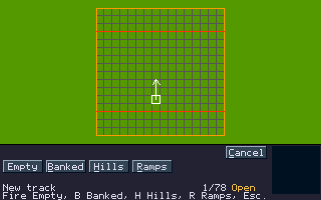

| Button | Key | What you get |
| --- | --- | --- |
| **Empty** | **Space** or **Fire** | Only the start line, on the map page. |
| **Banked** | **B** | Banked Loop, ready to drive. |
| **Hills** | **H** | Small Hills, ready to drive. |
| **Ramps** | **R** | Ramp and Hills, ready to drive. |
| **Cancel** | **Esc** | Back to the track. |

A ready-made track is a good way to start: drive it, change a section and drive it
again. **Banked**, **Hills** and **Ramps** are also on the map page. Such a track stays
in memory until you save it.

## Test drive

**Test** or **T** drives the track in memory when the state says **Ready** and no section
is being tried. Nothing is written: no track file and no lap record.

Drive with the joystick in port 2. **Esc** comes back from the chains, the crane or the
road. A wreck or the end of the fourth lap stops on the game's panel, where **Esc** does
nothing: press **Fire** or **Space** there.

You come back with the same track, section, view and undo steps, and line 2 says
`Back from the drive. Nothing was saved.` A key still held from the race does nothing
until you release it.

## Saving and loading

**Save** or **F1** saves, and **Load** or **L** loads. There are 32 slots on two pages.

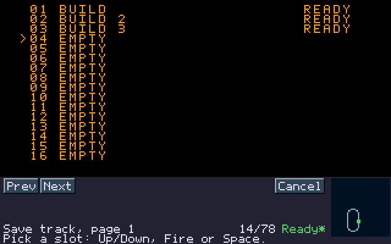

Click a row, or move with the arrows and confirm with **Space**, **Return** or **Fire**.
**Prev** and **Next** change the page. With the keys, moving past the last row reaches
them, and the button lights up. **Esc**, **Cancel** or a right click closes the list.

| In the list | Meaning |
| --- | --- |
| `EMPTY` | A free slot. |
| `DRAFT` | An unfinished track. It can be saved and continued later. |
| `READY` | A finished track. It appears in Practise. |
| `INVALID` | The track did not pass its checks. |
| `UNREADABLE` | The slot cannot be read. |

The first save of a new track selects the first free row. Saving over a used slot asks
first: **Replace** goes on, **Cancel** goes back.

Then you name the track.

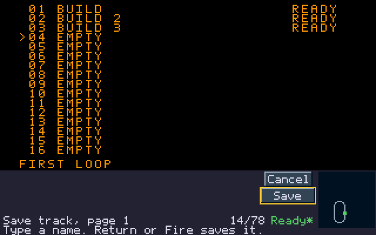

A name has 1-24 letters, digits or spaces. A new track offers `TRACK nn` from its row:
the first letter you type replaces it, **Backspace** edits it and **Return** or **Fire**
keeps it. **Space** types a space here.

**New**, **Load** and **Exit** protect unsaved changes. They ask first:

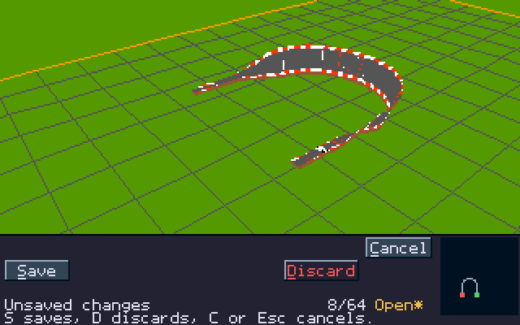

| Button | Key | What it does |
| --- | --- | --- |
| **Save** | **S** | Save, then go on. |
| **Discard** | **D** | Lose the changes and go on. |
| **Cancel** | **C** or **Esc** | Back to the track. |

### Where the tracks are

Each slot is a file in the install directory: `Track01.sct` to `Track32.sct`, with lap
records in `Track01.rec` to `Track32.rec` and the list in `TrackIndex`.

- Slots 01, 02 and 03 hold the example tracks **BUILD**, **BUILD 2** and **BUILD 3** until
  you save over them. They are ready to drive. Deleting `Track01.sct`, `Track02.sct` or
  `Track03.sct` brings that track back.
- Keep the install on a writable volume.
- With the icon's default settings WHDLoad writes a save to the hard disk at once, and
  the display goes blank for a moment while it does.
- To back up tracks, copy the files. Copy them between installs under the same names.
- A file renamed to another slot number shows as `UNREADABLE`. To move a track to
  another slot, load it and save it there.

## Driving and racing your tracks

Choose **Single Player League**, then **Practise**, then **Custom Tracks**. The list shows
your saved **Ready** tracks. Tracks that are open or do not pass the checks stay as
drafts in the editor.

Choose a track, and the game asks how to drive it:

- **Practise** drives the track alone.
- **Race** is a single race against a computer driver chosen at random.
- **Cancel** goes back to the track list.

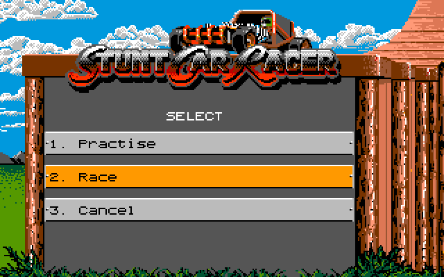

The computer driver races at the pace of the Little Ramp's opponent. **AI Difficulty** in
Settings makes it faster. Your car starts every race undamaged. The race is not part of
the league: your league damage, points and season times stay as they were. The next time,
the menu starts on the choice you made last.

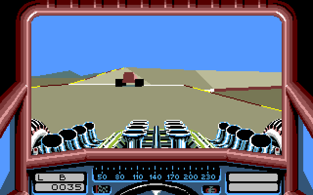

Custom tracks are not used in the league or in Computer Link, and the menu is there only in
single-player games.

Each track keeps its own best lap and race times, separately for Normal and Super. A race
time is a record only when you win the race. A record needs **Game Speed 100%**,
**Infinite Boost No**, **Disable Damage No** and **Timing Performance**. Other settings use
times for the session only.

- Records are written when you go back to the menus, after you leave Practise with **Esc**
  or after the race ends, so do that before you quit the game.
- A record belongs to the saved track and its exact shape. Renaming the track in the same
  slot keeps the record. Changing the shape starts fresh times.
- A copy in another slot has its own records.

After Practise, choose **Track Editor** in the track menu to go on with your project.
Driving does not replace what is in the editor.

`Records error: Retry` means records could not be loaded or saved. Check the install
and retry, or choose `Use session times only`. That gives up the pending record, not your
saved track.

## Controls

"Fire" is the joystick button. **T** means Test while building and Turn on the map page.

### While building

| Command | Mouse | Keyboard | Joystick |
| --- | --- | --- | --- |
| Select a section | **Prev**, **Next** | Left, Right | Left, Right |
| Add or edit | **Add**, **Edit** | Space | Fire |
| Remove | **Del** | Backspace | |
| Finish the track | **Finish** | F | |
| Undo, redo | **Undo**, **Redo** | U, R | |
| Overview | **View** | V | |
| Test drive | **Test** | T | |
| New track | **New** | N | |
| Save, load | **Save**, **Load** | F1, L | |
| Leave the editor | **Exit** | Esc | |
| Look around | Right button and drag | W, A, S, D, Q, Z | |

### With the choices open

| Command | Mouse | Keyboard | Joystick |
| --- | --- | --- | --- |
| Pick a section | Turn, slope, word | Left, Right go through all that attach | Left, Right |
| Place it | **Place** | Space | Fire |
| Close the choices | **Back**, right click | Esc or U | |

**Undo**, **Redo**, **Del** and **New** work here as buttons. The keys for them
work once the choices are closed.

### Anywhere

A right click closes what is open: a dialog, the choices or the overview.

A click during a long redraw is dropped, and line 2 says `Still drawing. Click again.`
That way a click never lands on what the screen no longer shows. Right after **Place**
line 2 may say `One moment.`, so that a double click does not place two sections. Just
click again.

## All sections

There are 36 sections. A section uses 1-9 of the 78 road pieces. Which ones you can choose
depends on how the road ends: along the map squares, or diagonally after a 45 or 135 degree
turn.

### Road ending along the squares

| Slope | Left | Ahead | Right |
| --- | --- | --- | --- |
| **Flat** | 90, 135, 180, Long 90 | Straight, Bumps, Dip | 90, 45, 135 |
| **Up** | 90, 180 | Small, Medium, Large, Coaster | 45, 90, Steep 90 |
| **Down** | 180 | Small, Medium, Large, Coaster | 90 |
| **Jump** | | Ramp, Hump, Large | Crest 180 |

### Road ending diagonally

| Slope | Left | Ahead | Right |
| --- | --- | --- | --- |
| **Flat** | 45, 135 | Straight | 135 |
| **Up** | 45 | | |
| **Jump** | | Large, Ramp | |

All corners are banked, as on the original tracks. There are no unbanked corners,
drawbridges or crossings.

**Bumps** is the bumpy start of Big Ramp: the left and the right edge rise in turn.
**Dip** is a shallow dip from Stepping Stones. The straight **Large** jump is the big hill
at the start of High Jump. The diagonal **Ramp** is the whole jump of Little Ramp: the
ramp, the gap and the landing. The diagonal **Large** is its first half, the ramp without
the gap and the landing.

## Messages

### After an action

| Line 2 | Meaning |
| --- | --- |
| `Track saved.` / `Track loaded.` | Done. |
| `Save failed.` / `Load failed.` / `Wrong or missing disk.` | It did not complete. A failed save keeps the track in memory, so do not leave the editor if it holds unsaved work. |
| `Empty slot.` | There is nothing to load in that row. |
| `Saved, but the index needs recovery.` | The track was saved but the list was not. Keep the install as it is. |
| `Index recovered from records.` | The list was rebuilt, for example after copying files. The next save writes it. |
| `Test needs a Ready track.` | Close the track first. |
| `Place or cancel the section first.` | **Test** does not work while a section is being tried. |
| `Let go of the key first.` | A key is still held down. |
| `Closed with 2 more sections.` and the like | What **Finish** did, see [Let the editor finish](#let-the-editor-finish). |
| `Found no way to close the track.` / `Found no way to fill the gap.` | **Finish** changed nothing. |

### Why a dimmed button is dimmed

| Line 2 | Button |
| --- | --- |
| `Nothing to undo.` / `Nothing to redo.` | **Undo**, **Redo** |
| `Only the start line is left.` | **Del** |
| `The start section stays.` | **Del** on the start section |
| `Fill the gap first.` | **Del** away from the gap, **Save** and **Test** while a gap is open |
| `The track is closed.` | **Finish** on a closed track |
| `This is the last section.` | **Next** |
| `The track is closed. Edit a section.` | **Add** on a closed track |
| `Test needs a closed, legal track.` | **Test** |
| `Place the start first.` | **Save** and **View** on the map page |
| `No section of this kind here.` | A turn or a slope |

### A track that is not Ready

| Line 2 | Meaning |
| --- | --- |
| `Ready to drive. Test it, or Edit a section.` | All is well. |
| `Draft: close both road edges.` | The road does not meet the start yet. |
| `Closed: road too short.` | Add more road. A track needs at least 8 road pieces. |
| `Closed: road overlap.` | Two parts of the road overlap. |
| `Closed: invalid start area.` | The start section is not a flat straight. |
| `Closed: road below side base.` | Part of the road is too low. Raise it. |
| `Closed: runtime check failed.` | The game could not prepare the track for driving. |
| `Draft: legacy unbanked geometry.` | A very old track, see below. |

## Limits and older tracks

- A track has up to 78 road pieces on a map of 16 × 16 squares.
- There are 32 save slots.
- A track must leave three squares behind and ahead of the start along its heading.

Tracks saved by older versions keep the shape they had. The choices then show **Prev**
and **Next** instead of the turn and slope buttons, as they also do when you replace a
section, and **Del** removes one road piece at a time from the end. Use **New** to start a track with whole original
sections. Some of the oldest tracks stay as drafts and cannot be driven.

Saved tracks from the 16-slot game disks cannot be converted.
